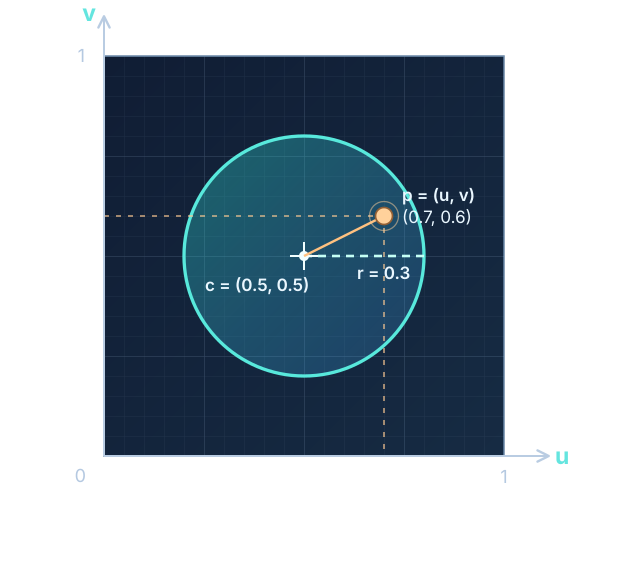
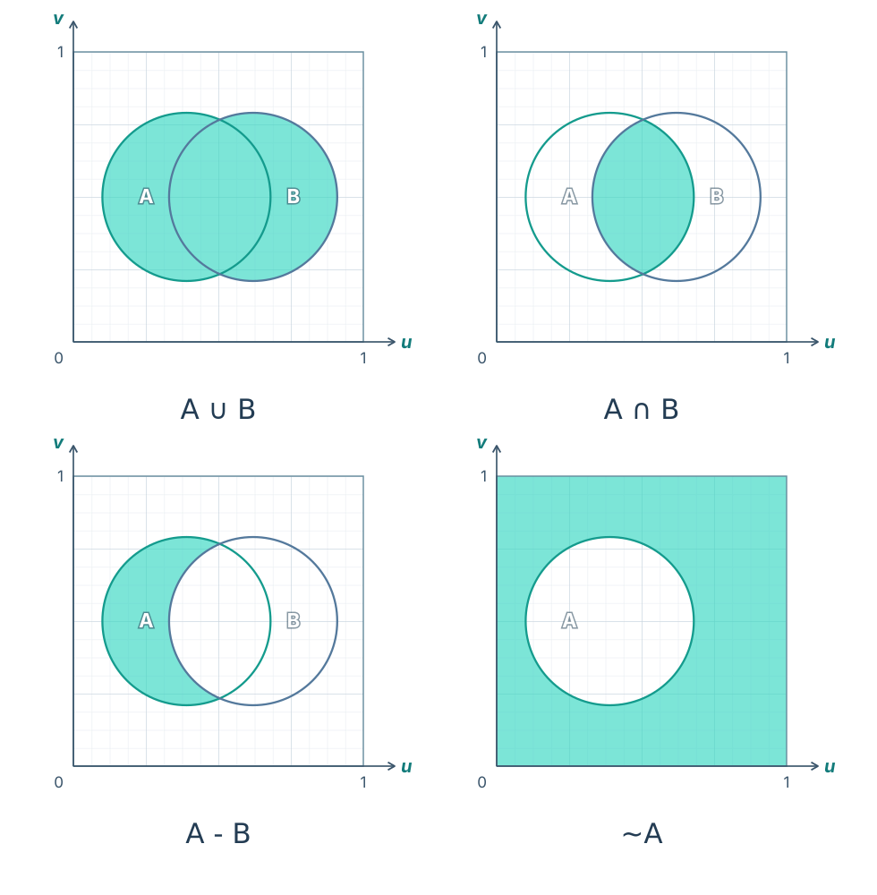

## SDF로 그림그리기

셰이더로 그림을 그릴 때의, 가장 처음 배우게되는 기본 도형은 원이다.

여기서 말하는 "그린다"라고 하는 건, 어떤 색이 칠해질 영역을 지정하는 것을 말한다.

그리고 영역이란 곧 부등식을 의미한다.

---

### 원 그리기

버텍스 셰이더에서 텍스처 전체를 대상으로 하는 정사각형을 그린다고 하자.

픽셀 셰이더에서는 픽셀 좌표 `(u, v)`마다 셰이더 코드가 실행되므로, 각 픽셀이 영역에 포함되었는지 아닌지는 부등식으로 확인할 수 있다. 가장 기본이 되는 원은 다음과 같이 그릴 수 있다.

```
vec2 c = vec(0.5);
float r = 0.3;

float4 ps_main(float2 uv){
	float d = length(uv - c) < r;
	bool inside = d < 0.0;
	
	if(inside){ /* ... */ }
	else{ /* ... */ }
}
```



---

### 원 합성하기

원 하나의 영역이 부등호로 표현된다면, 여러 원으로 만들어진 영역은 어떻게 만들까?



부등식이 곧 영역이므로, 부등식에 대한 논리 연산으로 여러가지 모양을 그릴 수 있다.

---

### SDF로의 확장

그런데, 그냥 부등식을 사용하면 확장성이 조금 떨어진다. 부등식만으로는 경계의 내/외부라는 이진값만 알려줄 뿐 경계까지의 거리같은 정보가 소실되기 때문이다.

따라서, 이를 조금 확장해서 SDF(Signed Distance Function)으로 만들자. 0을 경계로, 미만은 내부 초과는 외부로 판정하는 함수이다.

영역 A에 대한 SDF를 `A(x)`, 영역 B에 대한 SDF를 `B(x)`라 할 때, 논리 연산은 자연스럽게 다음과 연결된다.

|   논리 연산   |      대응되는 함수       |
| :-------: | :----------------: |
| $A\cup B$ | `min(A(x), B(x))`  |
| $A\cap B$ | `max(A(x), B(x))`  |
|   $A-B$   | `max(A(x), -B(x))` |
| $\lnot A$ |      `-A(x)`       |

---

### 부드러운 경계

`min`, `max`는 둘 중 하나만을 딱 잘라 선택한다.

따라서, 각 함수가 아무리 부드럽더라도 딱 떨어지는(hard) 경계가 만들어질 수밖에 없다.

이를 방지하기 위해(두 도형의 경계를 부드럽게 섞기 위해), `min`과 `max`대신 `smoothmin`(혹은 `smooth union`, `smin`)과 `smoothmax`(`smooth intersecion`, `smax`)함수를 사용한다.

가장 많이 사용되는, polynomial smoothmin / polynomial smooth max는 다음과 같이 정의된다.

$$\text{smin}(a,b,k)=\text{min}(a,b)-\frac{\text{max}(k-|a-b|,0)^2}{4k}$$

$$\text{smax}(a,b,k)=\text{min}(a,b)+\frac{\text{max}(k-|a-b|,0)^2}{4k}$$

여기서 $k$는 부드럽게 만들 범위를 조절한다. smin을 구체적으로 따져보면 아래와 같다.

- $|a-b|\ge k$:  보정값이 0이되므로, `smax(a, b, k) = min(a, b)`이다.
- $|a-b|\lt k$: 보정값이 0이 아니므로, `smax(a, b, k) < min(a, b)`이다.

여기서 또 주목할 점은 "언제 가장 보정이 크게 들어가는가?"이다.

- $k-|a-b|$가 가장 클 때, 보정이 가장 크게 들어간다. 여기서, k는 보정 상수이므로...
- $a=b$이면 보정이 가장 커져서, 실제 SDF값보다 $k/4$만큼 감소한다.

SDF가 0 미만일 때 영역 내부로 판정하므로, A와 B 두 영역에서 똑같이 떨어진 곳(즉, 영역의 경계)에서 실제 경계보다 더 넓은 영역을 "영역 내부"로 판정하게 된다.

smax도 동일한 논리로 보정을 할 수 있다.