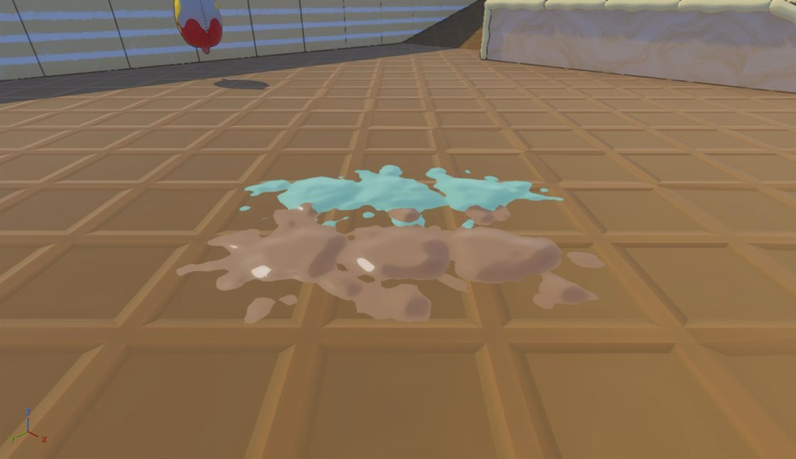

## MintChoco 프로젝트 개요
---
MintChoco는 민트vs 초코를 테마로 한 페인트를 칠해서 영역 싸움을 하는 멀티 pvp 게임이다. 본격적으로 게임을 만들어본 것은 이번이 처음이었고, 나는 Paint 시스템을 만드는 것에 가장 신경을 많이 썼다.

- 사용 엔진: Unreal Engine
- 작업 기간: 2026.08.31. ~ 2026.09.17. (약 3주)
- 제작 인원: 프로그래머 2명, 기획자 3명, 아티스트 2명

## Paint 시스템
---

### 1. 구현 전 내 생각들

Paint 시스템을 본격적으로 만들기 전에 처음에는 여러가지 생각이 들었다.
- 두 Paint가 겹쳤을 때 어떻게 부드럽게 이어지는 거지?
- Paint 모양은 어떻게 만들어야 자연스럽게 Paint처럼 보이지?
- 멀티 게임인데 Paint에 대한 Replication은 어떻게 해야하지?
- 어떤 Paint가 어디에 붙을지를 어떻게 정하지?
- Paint로 점수 판정은 어떻게 해야하지?

가장 중요한 건
1. 뭔가 페인트가 붙을 수 있는 벽이 있고,
2. 충돌 시에 그 벽에 대해서 어떤 이벤트가 발생하고,
3. 이벤트 발생하면 Paint를 실제로 그린다.

이런 흐름을 만드는 것이라고 생각해서,
- 먼저 PaintableComponent를 두고 벽 Actor에 붙을 수 있게 만들고
- 마우스 피킹을 통해 그 위치에서 Splat 이벤트가 발생
하는 것부터 만들었다. 우선 테스트하기 쉬운 구조를 만드는 게 중요하다고 생각했기 때문이다.

### 2. 실제 구현

Unreal Engine에서 만든 최종 결과물은 아래와 같다.

UE에서 AI와 만든 결과물을 이해해보고자, 내 CrowyEngine에서 다시 구현해보면서 구현 과정을 설명해보려한다. 모든 걸 구현하진 않았고, 가장 신경 쓴 부분 중 몇몇만 구현했다. 포팅에도 AI의 도움을 받았다.

### 3. Paint 구성

- [Paint RenderTarget 구성](Paint%20RenderTarget%20구성.md)
- [Paint와 점수 판정](Paint와%20점수%20판정.md)
- [페인트 모양](셰이더로%20페인트%20모양%20만들기)

### 프로젝트 회고

짧은 개발 기간 압박에 AI를 많이 사용한 나머지 실제 구현에 많은 신경을 쓰지 못했다. 그럼에도 불구하고 주목할만한 점은, 원래는 AI에게 맡기다보면 갑자기 작업 중에 막막한 부분이 생기는 데 이번에는 그런 경험을 거의 하지 못했다는 것이다.

요점은, AI 자체가 문제가 있는 툴은 아니라는 것이다. 사용자가 자신이 AI에게 요청한 지시에 대한 기초 지식이 충분히 쌓여있다면, 그만큼 AI는 사용자의 의도대로 동작하고 그렇지 않다면 문제가 생긴다는 것이다.

그럼에도 불구하고, UE의 렌더링 과정을 제대로 이해하지 않고 추정하며 만들었기에, 이 부분에 대해서는 확인이 필요하다. 그래서 CrowyEngine에서 다시 구현하면서 동작 과정을 이해해봐야할 것 같다.