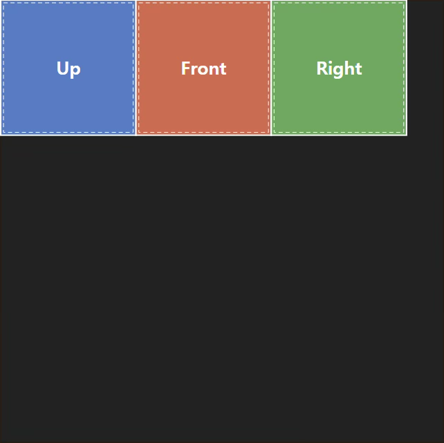
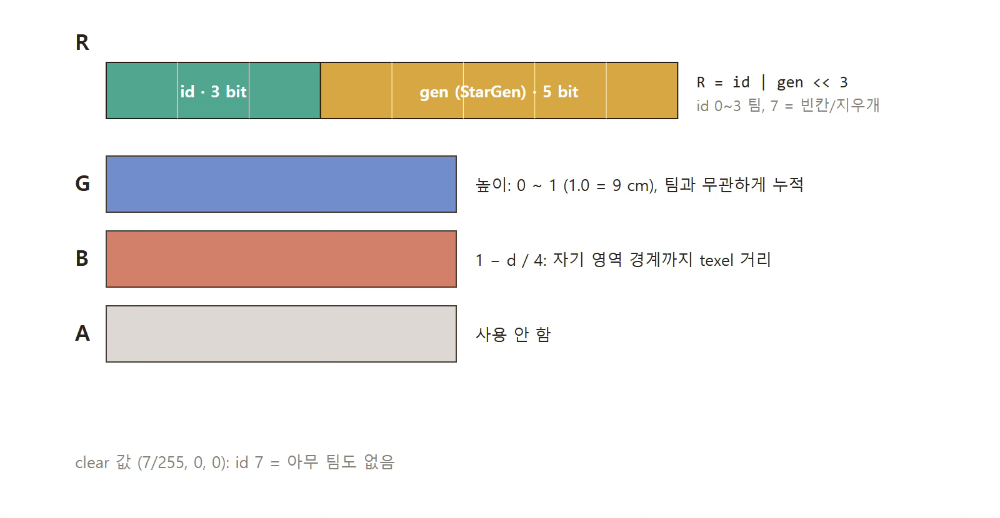

## RenderTarget2D

이 페이지에서는
1. 왜 RenderTarget2D를 사용했는지,
2. RenderTarget2D 내부는 어떻게 구성되어있는지
설명한다.

RenderTarget2D는 말은 거창하지만, 간단하게 그냥 텍스처이다.

---
### RenderTarget2D와 Decal의 차이점

Paint가 벽 위에 덮힌다는 점에서 Decal을 사용하는 것을 먼저 고려해볼 수 있다.
Decal은 매 프레임 unit cube을 draw하는 방식으로 동작한다. 구체적으로는, unit cube를 그리는 게 아니라 unit cube 하나를 화면에 투영하는 방식으로 그린다.

```cpp
// Unreal Engine (5.8.2-release), PostProcessDeferredDecals.cpp:729-777
for (uint32 DecalIndex = DecalIndexBegin; DecalIndex < DecalIndexEnd; ++DecalIndex)
{
	// ...
	uint32 InstanceCount = View.UsesInstancedStereoShaders() ? 1 : View.GetStereoPassInstanceFactor();

	RHICmdList.DrawIndexedPrimitive(GetUnitCubeIndexBuffer(), 0, 0, 8, 0, UE_ARRAY_COUNT(GCubeIndices) / 3, InstanceCount);
}
```

즉, 데칼이 추가되면 추가될수록 매 프레임 Draw Call이 늘어난다. Decal의 가장 흔한 사용 예시인, 총탄 자국처럼 잠깐 있다가 사라지는 경우에는 이런 draw call 증가가 감내할 만하다.
그러나, 우리의 경우 한 게임 내내 Paint가 지워지지않고 쌓여야 하므로 draw call 증가가 신경쓰인다. 정확히는, 한 RenderTarget2D에 Paint를 추가하는 draw 비용은 decal과 비슷할지 모르지만, 그 누적된 Paint들이 쌓였을 때 쌓인 Paint에 대해서 Decal은 draw call 비용이 O(n)으로 늘어나고 RenderTarget2D는 O(1)이다.

```cpp
// Unreal Engine (5.8.2-release), DecalRenderingShared.cpp:489-556
FVisibleDecalList BuildVisibleDecalList(TConstArrayView<FDeferredDecalProxy*> Decals, const FViewInfo& View)
{
	// ...
	for (const FDeferredDecalProxy* DecalProxy : Decals)
	{
		// ...

		if (!(bIsVisibleInFirstView || bIsVisibleInSecondView)) continue;
		
		// ...

		if (FadeAlpha <= 0.0f) continue;


		VisibleDecals.Emplace(*DecalProxy, ConservativeRadius, FadeAlpha, ShaderPlatform, View.GetFeatureLevel());
	}
}
```

그리고, 데칼은 시야에 들어왔는지에 대한 컬링만 존재할 뿐, 데칼 간 가려지는 것에 대한 컬링은 존재하지 않는다. 우리 페인트는 계속 그 위에 덮이는 식으로 동작해야하므로 이것 또한 신경쓰인다. (마찬가지로, 측정해보진 않았다.)
게다가, `FadeScreenSize`로부터 계산되는 `FadeAlpha`의 의미는 멀리있는 페인트를 사라지게 만드는 데, 게임 상태를 화면에서 안 보이게 만드므로 이 또한 Decal이 적절하지 않음을 뜻한다.


```cpp
// Unreal Engine (5.8.2-release), DecalRenderingShared.cpp:457-487
void SortDecalList(FRelevantDecalList& Decals)
{
	Decals.Sort([](const FVisibleDecal& A, const FVisibleDecal& B)
	{
		if (B.SortOrder != A.SortOrder)
			return A.SortOrder < B.SortOrder;

		if (B.BlendDesc.bWriteNormal != A.BlendDesc.bWriteNormal)
			return B.BlendDesc.bWriteNormal < A.BlendDesc.bWriteNormal;

		if (B.BlendDesc.Packed != A.BlendDesc.Packed)
			return (int32)B.BlendDesc.Packed < (int32)A.BlendDesc.Packed;

		if (B.MaterialProxy != A.MaterialProxy)
			return B.MaterialProxy < A.MaterialProxy;

		return B.Component < A.Component;
	});
}
```

또 정렬에 있어서도, 먼저 칠해지는 데칼을 뒤로 보낼 방법이 `SortOrder`뿐인데 엔진에서 아래와 같이 경고하므로 사실상 고려 대상이 아니다.
```cpp
// Unreal Engine (5.8.2-release), DecalComponent:36
Setting many different sort orders on many different decals prevents sorting by state and can reduce performance.
```

정리하자면, Decal 대신 RenderTarget2D를 써야하는 이유는 아래와 같다.
1. 데칼은 추가되면 추가될 수록 Draw Call이 늘어난다.
2. 데칼 간 컬링이 전무하므로, Decal 늘어나는 대로 고스란히 Draw Call 비용 증가로 이어진다.
3. 데칼 정렬이 사실상 불가능하다.

---

### RenderTarget 구성



RenderTarget2D라는 텍스처를 그러면 어떻게 만들 것인가. PaintableComponent가 붙을 실제 메시가 그다지 복잡하진 않을 것이다.
다만, 약간의 변형에도 Paint를 그릴 수 있도록 대응하는 건 필요하고, 또 Mesh의 모든 면이 칠할 수 있는 게 아니라 바닥 면에만 칠할 수 있게 면의 방향에도 대응해야한다.

이를 위해서 CubeMapping에서 아이디어를 얻어, 방향 별 island로 구성된 Atlas 형태로 만들자. 그 Island의 활성화는 PaintableComponent에서 고를 수 있게 만든다. (이를 보고 RenderTarget2D를 패킹한다.)

읽는 방법은 픽셀 별로 구한 노말 벡터를 이용한다.
1. x, y, z중 어느 축이 가장 큰 지 그리고 그 축의 부호를 이용해 읽을 면을 정한다.
2. 남은 두 축 값을 uv처럼 사용해서 저장된 값을 읽는다.



RenderTarget2D안에 저장된 건 실제 Color은 아니다. 각 채널 별, 비트 별 역할을 부여해서 사용했다.
- R채널 하위 3비트: id buffer로, 칠해진 팀 색깔을 뜻한다.
- R채널 상위 5비트: 특정 아이템 사용 시 칠해진 id값 변경을 막기 위한 generation 값.
- G채널: height map: 페인트가 평평하면 밋밋하므로, 얼마나 많이 누적되었는지 저장한다.
- B채널: 색깔 별 경계선을 부드럽게 만들기 위한, 경계선 까지의 texel 거리.
