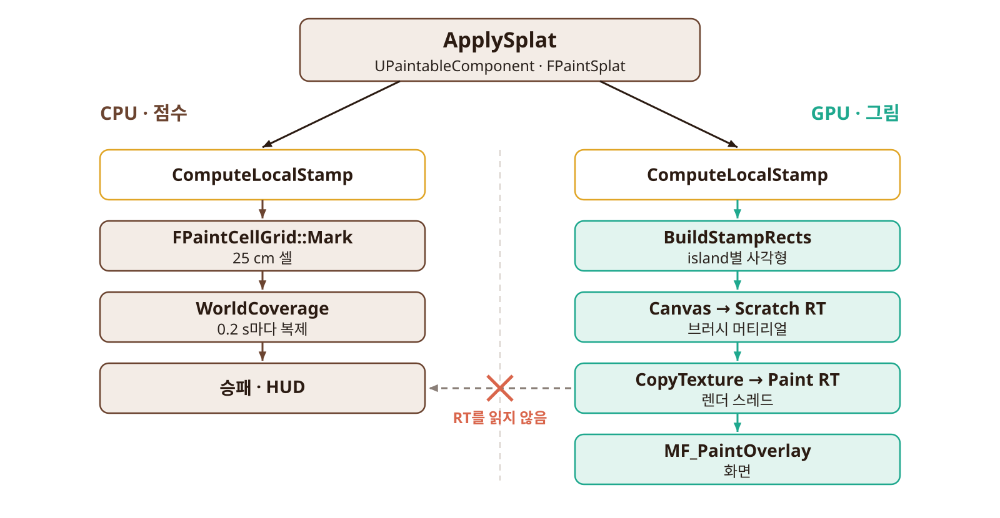
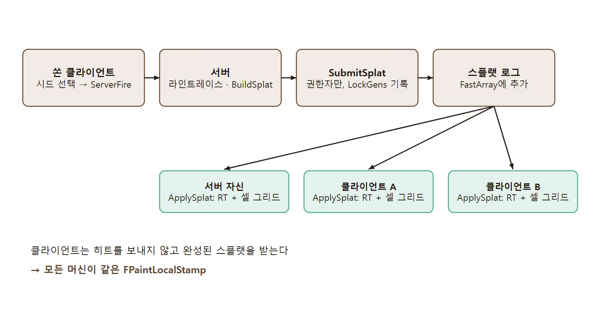

## Paint와 점수 판정

이 페이지에서는 MintChoco 프로젝트에서 비주얼적인 연산(GPU 경로)과 게임 규칙 연산(CPU 경로)를 어떻게 나눴는지 설명한다.

---

### GPU 경로와 CPU 경로를 왜 나눠서 생각?

짧게 얘기하자면 GPU에 시키기 적합한 연산과 CPU에 시키기 적합한 연산은 다르기(최적화) 때문이다.
그러나 Splatoon에서처럼, 비주얼적인 요소가 게임 규칙에 반영이 되어야한다면 다소 미묘해진다. 페인트가 칠해진 걸 그대로 점수로 사용한다는 뜻은, GPU가 계산한 데이터를 CPU가 사용한다는 뜻이다. 그건 곧, GPU Readback을 의미하는 데, sync point가 존재하는 순간 CPU가 멈추는 순간이 있다는 것이다.

가장 이상적으로는, GPU는 CPU 데이터를 받기만 하는 것이다. 그런데, Paint를 점수로 사용하려면 GPU데이터를 CPU가 받아야 한(할 것 같)다. 이를 어떻게 해결할까?

---

### 점수 판정과 비주얼은 완전히 똑같을 필요가 없다.

유저 입장에서는 1px정도 보이는 것과 판정이 다르다고 해서 크게 신경쓰이지 않는다. 즉, 어느정도의 비주얼과 판정의 미스매치는 감내할 만하다는 것이다. 다만, Paint의 위치나 크기가 너무 다를 경우에는 거슬릴 것이다.

그렇다면, Splat 이벤트는 동일하게 발생하는 데 그 후에 이어지는 CPU/GPU 경로는 분리하게 하자.

GPU 경로에서는 [RenderTarget](Paint%20RenderTarget%20구성.md)에 그리고, CPU 경로에서는 (25cm 정도의) 셀 그리드를 통해 점수를 계산하자. 그러면 아래처럼 된다.

---

### 서버와 클라이언트, CPU와 GPU

CPU 경로와 GPU 경로라고 말을 했지만, 사실 "점수 판정"과 "비주얼"이라는 점에서 서버와 클라이언트를 빼놓고 얘기할 수는 없다.
어느 클라이언트에서든 Splat 이벤트를 발생시킬 수 있고, 다른 클라이언트가 발생시킨 Splat 이벤트 결과를 볼 수 있어야하고, 그렇지만 서버만 점수 계산을 할 수 있어야하기 때문이다.

이벤트 발생 흐름은 다음과 같다.

1. A 클라이언트에서 Splat Event가 발생한다.
2. A 클라이언트는 곧바로 점수 계산 & Paint Draw를 수행한다. 그리고 서버에 전송한다.
3. 서버는 Splat Event를 Splat 로그(FastArray, Replication 대상.)에 기록한다.
4. Replication에 의해 다른 클라이언트에서도 이벤트가 실행된다.
5. 서버에 의해 WorldCoverage(총합 점수)가 갱신되고, Replication에 의해 A 클라이언트가 잘못 계산하더라도 덮어씌워진다.

서버와 클라이언트가 필요한 정보만 생각해본다면, 서버는 점수 계산을 해야하고 나머지 클라이언트는 Paint Draw만 수행해야한다. 우연히도, 점수 계산이라는 CPU 경로와 Paint Draw라는 GPU 경로를 분리했기에, 로직 상으로 어느 부분은 서버가 수행하고 어느 부분은 클라이언트가 수행해야하는지에 대한 분리도 같이 얻어간 셈이다.
