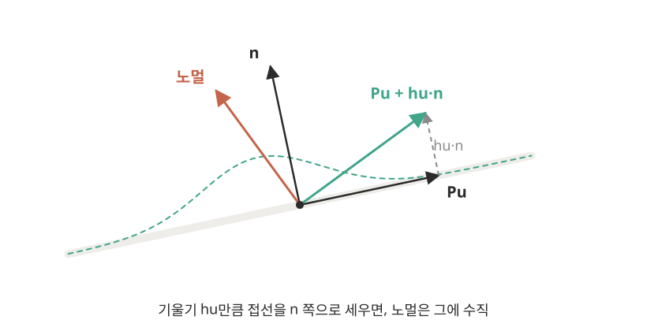
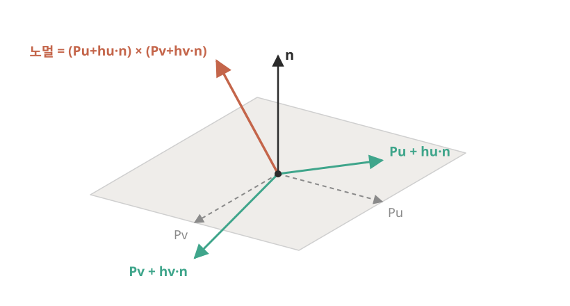
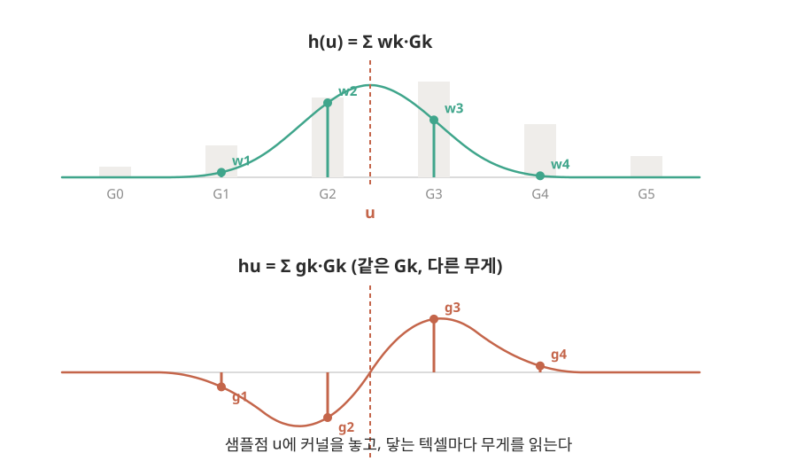
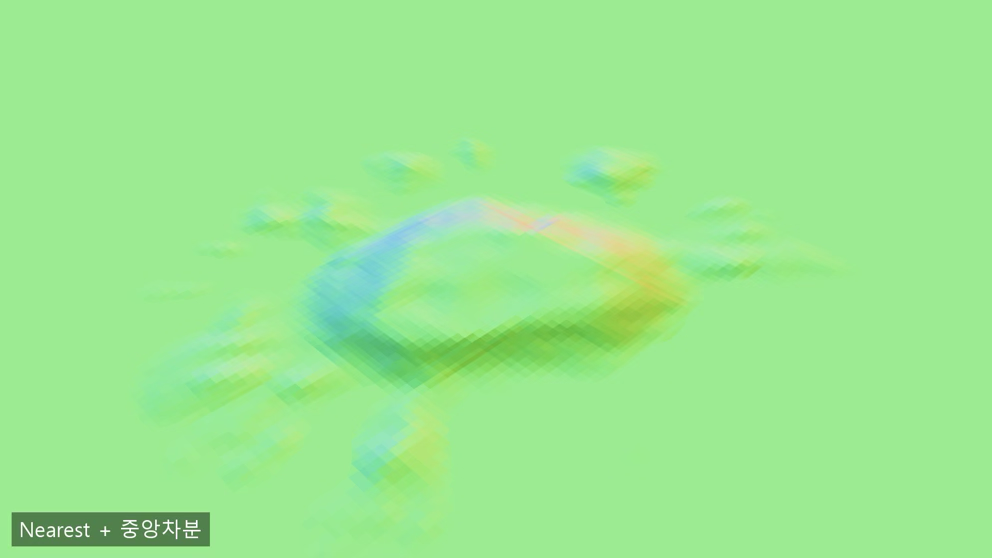
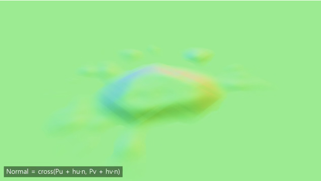

## 높이 맵을 노멀로 바꾸기

Paint가 누적됨에 따라 더 튀어나오게 만드는 방법은 높이맵(내 경우는 RenderTarget의 G채널)을 두고, Splat 이벤트마다 누적시키는 것이다.

그런데, 이렇게 누적시켜서 구한 높이 값을 실제로 사용할 때는 노멀이 필요한데, 어떻게 변환할 것인가?

이 페이지에서는 그 변환 방법을 설명한다.

---

### 기본 원리

모델 공간 상 (페인트 없는) 표면의 접선 $\text{Pu}$, $\text{Pv}$가 있다고 하자. 이 벡터는 position map에 있다.

그리고, height map에서 $\text{u}$, $\text{v}$방향으로의 변화할 때, height의 변화 $\text{hu}=\frac{\partial h}{\partial u}$, $\text{hv}=\frac{\partial h}{\partial v}$를 구할 수 있다.

그러면 본래 표면의 노말 $\text{n}$으로부터, 다음 두 벡터를 얻을 수 있다.

$$\text{Tu}=\text{Pu}+\text{hu}\cdot\text{n}$$

$$\text{Tv}=\text{Pv}+\text{hv}\cdot\text{n}$$

이제, $\text{Tu}$, $\text{Tv}$로부터 cross product로 새로운 노말을 만들 수 있다.

$$\text{N}=\text{Tu}\times\text{Tv}$$

---

### 샘플링 문제

$\text{hu}$, $\text{hv}$에 대해서 좀 더 생각해보자.

가장 간단하게는, 양 옆의 텍셀을 차분해서 구하는 것이다.

$$\text{hu}=\frac{G[k+1]-G[k-1]}{2}$$

그런데, 문제는 픽셀 셰이더가 받는 UV는 연속 값인 반면, 실제 텍셀은 **불연속**이라는 것이다.

높이 맵으로부터 가상의 연속된 곡면을 상상해보자. 그 곡면 위에서 샘플링하지 않고 실제 height map에서 바로 샘플링한다면, UV가 k번 칸 어디에 있든 똑같이 G\[k\]를 샘플링할 것이다.

따라서, cubic B-spline으로 구한 가상의 연속된 곡면 $\text{h}(u,v)$위에서의 기울기를 구하는 게 더 부드러울 것이다.

### Cubic B-spline에서 샘플링하기

cubic B-spline의 커널 $\text{B}(x)$는 폭이 4텍셀인 종 모양이다.

샘플링 할 $u$는 커널을 거쳐 가중치 $\text{wk}=B(k-u)$를 얻는다.

이를 통해 얻은 가상 곡면은 아래과 같다. (우선 u에 대해서만 다루자.)

$$\text{h}(u)=\Sigma\text{wk}\cdot G[k]$$

가중치 $\text{wk}$는 u에 대해서 연속적으로 바뀌므로, $\text{h}(u)$도 매끈하다. 이때, $\text{h}(u)$는 cubic이므로 2차까지 미분 가능하다.

우리가 구하고 싶은 건 $\text{hu}$. 즉, 변화량이므로 $\text{h}(u)$를 미분하면 아래와 같은 $\text{hu}$를 얻는다.

$$\text{hu}=\Sigma(-B'(k-u))\cdot G[k]=\Sigma\text{gk}\cdot G[k]$$

이 $\text{hu}$를 중앙 차분 대신 사용하면 좀 더 부드러운 노말을 구할 수 있다.

---

