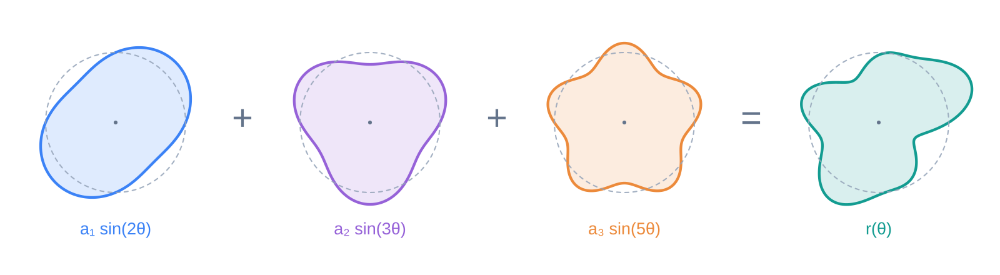
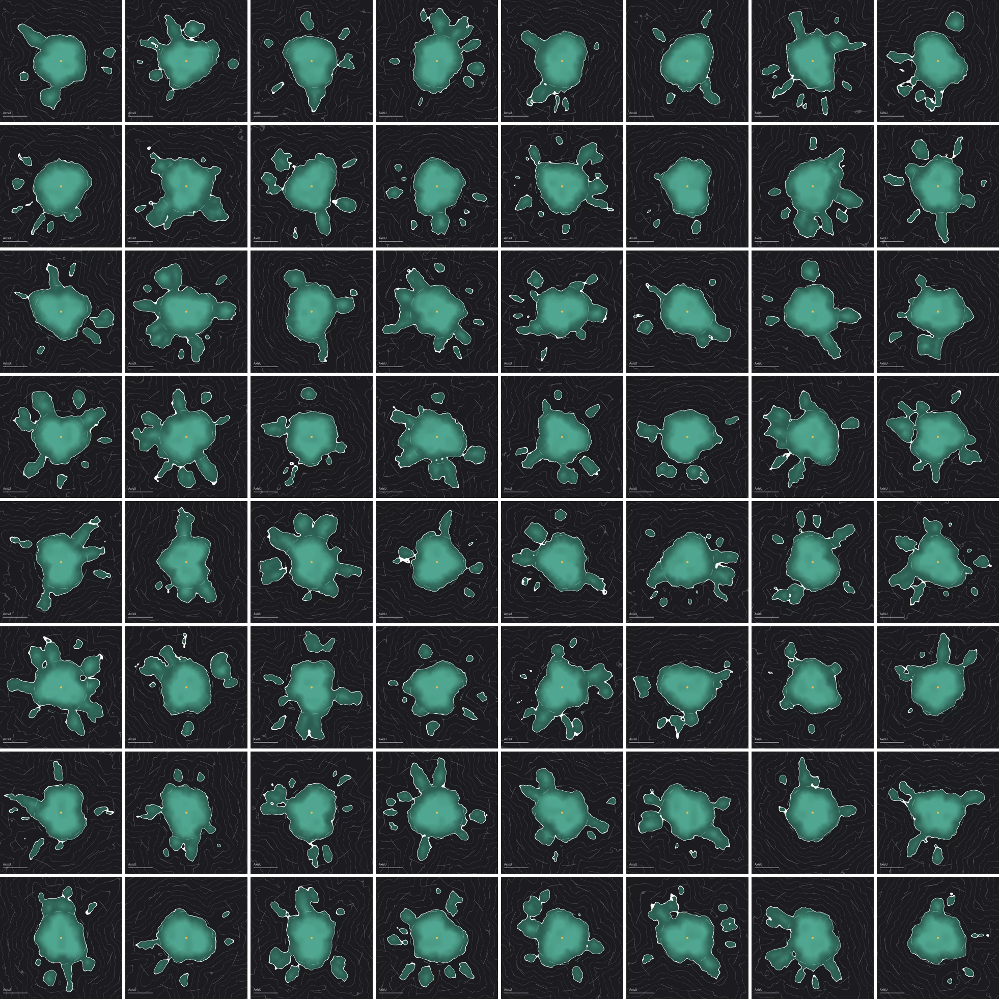

## 페인트 모양 만들기

이 페이지에서는 하나의 Splat Event에 대한 페인트 모양을 어떻게 만들었는지 설명한다.

---

### 페인트 모양에 대한 간단한 고찰

페인트는 액체이다. 액체는 기본적으로 표면 장력에 의해 구형을 유지하려 한다. 다만, (물리적 원리로는) 표면과 액체의 힘과 액체 내 분자 간 힘에 따라서 완전히 구형은 아니며, 또 액체에 가해진 힘에 의해 표면이 버티지 못하고 여러 개의 방울로 나뉘기도 한다. 따라서 핵심은 아래와 같다.

- 기본적으로, 방울은 구형(원형)이다.
- 완벽한 구는 아니라서 일부 찌그러져있어야 한다.
- 가해진 힘에 의해 몇몇 방울로 쪼개진다.

---

### 페인트 모양 구현

기본적인 모양은 원으로 잡는다. 그 방법은 [여기](../ComGraphics/SDF로%20그림그리기.md)에서 확인할 수 있다.

여기에 더해서, 원의 경계$r_0$이 wobble하게 만드는 방법은 아래와 같다.

- 우선 (u, v)로부터 중심을 기준으로 한 각도 $\theta$를 구한다.
- 그리고, $r_0$을 기준으로, 각도마다 출렁이도록 $\text{sin}$함수를 합성한다.
- 그렇게 만든 $r(\theta)$를 $r$로 사용한다.

$$r(\theta)=r_0+a_1\text{sin}(2\theta)+a_2\text{sin}(3\theta)+a_3\text{sin}(5\theta)$$

---

CrowyEngine에서 구현한 결과

